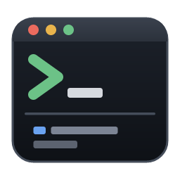

# Terminal Conductor



[English](README.md) | 日本語

Windows 用のターミナルアプリです。数十のプロジェクトで [Claude Code](https://code.claude.com/docs/en/overview) を並行して使う人向けに作りました。

## できること

- **プロジェクトごとに上下 2 ペイン**：上は AI の CLI 用、下はコマンド用（cmd / PowerShell）です。どちらも普通のシェルで、設定でオンにしない限り AI が勝手に起動することはありません。
- **再起動しても戻る**：開いていたプロジェクトと分割の比率を覚えています。前回 Claude Code の会話があったペインには「再開する」ボタンが出て、押すと `claude --resume <セッション ID>` で同じ会話に戻ります（設定で自動起動をオンにすると、押さなくても再開します）。
- **状態が一目で分かる**：各プロジェクトの AI が 作業中 / 許可待ち / 完了 / エラー のどれかをサイドバーに出します。Claude Code・Codex CLI・Antigravity CLI に対応しています。裏のプロジェクトが許可待ちや完了になったら、Windows の通知でも知らせます。
- **「これ何だっけ」をなくす**：一言説明、タグ、Claude の最後の返答、git のブランチと変更の有無、最終活動日時を一覧に出します。README などから Claude に要約を作らせることもできます。Ctrl+K で検索して開けます。
- **今の会話から移行できる**：追加したプロジェクトには、そのフォルダの直前の Claude Code の会話を `claude --continue` で続けるボタンが出ます。ほかのターミナルで続けていた会話を、そのまま持ってこられます（ほかのターミナルの Claude は先に終了してください）。
- **どのフォルダで話したかを探せる**：Ctrl+Shift+F で、Claude Code・Codex CLI・Antigravity CLI（`agy`）との過去の会話を、言葉・ファイル名・エラー・フォルダ名で検索できます。結果を選ぶと、そのフォルダを開いて会話を再開します。オンにするまでは何もしません（[会話の検索](#会話の検索)）。
- **英語と日本語の UI**：設定で切り替えられます（既定は Windows の表示言語に従います）。
- **自動更新**：新しい版が GitHub Releases に出ると、設定画面からダウンロードして更新できます。

## インストール

[Releases](https://github.com/cignoir/terminal-conductor/releases/latest) から `terminal-conductor_<版>_x64-setup.exe` をダウンロードして実行します。インストールはユーザー単位で、管理者権限は要りません。

- インストーラーにはコード署名（Authenticode）をしていないため、初回は SmartScreen の警告が出ることがあります。「詳細情報」→「実行」で進めてください。
- 更新ファイルは Tauri の updater 用の鍵で署名しています。アプリは、この署名を確かめられた更新しか適用しません。

### 必要なもの

- Windows 10 1809 以降（ConPTY を使います）。動作確認は Windows 11 で行っています。
- [Claude Code](https://code.claude.com/docs/en/overview)。`claude` が PATH にあること。動作確認は Claude Code 2.1.322 で行っています。

## Claude Code との連携のしかた

- 状態表示には Claude Code の [hooks](https://code.claude.com/docs/en/hooks) を使います。hook の設定は、アプリが Claude を起動するたびに `claude --settings <アプリのデータフォルダ>\tc-hooks.json` で渡します。**`~/.claude/settings.json` は書き換えません**。ユーザー設定の hook もそのまま動きます。
- 各ペインのシェルでは、`claude` が `--settings` 付きで動くようにエイリアスを定義しています（cmd は doskey、PowerShell は関数）。どちらのペインで手で `claude` と打っても状態が表示されます。
- **Codex CLI と Antigravity CLI** は、OSC 7501（`ESC ] 7501 ; state=working:app=codex BEL`）でターミナルに状態を送ります。アプリはこれをペインの出力から読むので、これらのツールの設定は一切触りません。Antigravity CLI は対応していると判定したターミナルにしか送らないため、ペインには `AGY_CLI_OSC7501=on` を設定しています。動作確認は Codex CLI 0.167.2 と Antigravity CLI 1.5.6 で行いました。自動起動と「再開する」ボタンは Claude Code だけです。ほかのツールの会話は、会話の検索から再開できます。
- hook から届くのは、イベント名、セッション ID、Claude の最後の返答などです。これらは同じユーザーだけが書き込める named pipe でアプリに渡り、アプリのデータフォルダにだけ保存されます。外部には送りません。
- 外部と通信するのは、更新の確認（GitHub）と、ボタンを押したときの要約の生成（`claude -p`。Claude Code 自身の通信）だけです。

## 会話の検索

Ctrl+Shift+F（またはサイドバーの「会話を検索」）で、ツールをまたいで過去の AI との会話を検索し、その会話に戻れます。

| ツール | 読むもの | 検索の対象 | 再開のコマンド |
|---|---|---|---|
| Claude Code | `~/.claude/projects/*/*.jsonl` | あなたの発言と Claude の返答 | `claude --resume <id>` |
| Codex CLI | `~/.codex/sessions/**/rollout-*.jsonl[.zst]` | あなたの発言と Codex の返答 | `codex resume <id>` |
| Antigravity CLI | `~/.gemini/antigravity-cli/conversation_summaries.db` | タイトルとプレビュー | `agy --conversation <id>` |

プライバシーとセキュリティ：

- **既定ではオフ**です。初めて開いたときに何をするかを説明し、同意を得てから索引を作ります。
- すばやく検索するため、索引に**会話のテキストのコピー**を持ちます（ツールの出力は除く）。会話に貼り付けたキーやパスワードなども、このコピーに含まれます。
- 索引は `%LOCALAPPDATA%\io.github.cignoir.terminal-conductor\history.db` に置きます。ローミングしないローカルのフォルダなので、ローミングプロファイルでサーバーにコピーされることはありません。外部にも送りません。消えた会話は SQLite の `secure_delete` で索引から消します。
- 設定の「索引を削除」でファイルごと消せます。元の会話の記録は書き換えません。Antigravity の DB は読み取り専用で開きます。
- 再開のコマンドは、会話 ID が単純な ID（英数字・`-`・`_`）のときだけ上のペインに打ち込みます。ペインがすでに動いていた場合は先に確認し、断るとコマンドをコピーします。

## 操作

| キー | 動作 |
|---|---|
| Ctrl+K | プロジェクトを検索して開く |
| Ctrl+Tab / Ctrl+Shift+Tab | 開いているプロジェクトを順に切り替え |
| Ctrl+1〜9 | n 番目のプロジェクトへ |
| Alt+↑ / Alt+↓ | Claude ペインとシェルペインの間を移動 |
| Ctrl+C（選択中）/ Ctrl+Shift+C | コピー |
| Ctrl+V / 右クリック | 貼り付け（選択中に右クリックするとコピー） |
| Shift+Enter | Claude の入力欄で改行 |
| Ctrl+Shift+F | 過去の AI との会話を検索 |
| Ctrl+, | 設定 |
| プロジェクトを右クリック | エクスプローラーで開く・開く・編集・閉じる |

## データの保存先

`%APPDATA%\io.github.cignoir.terminal-conductor\`

| ファイル | 内容 |
|---|---|
| `projects.json` | プロジェクト台帳 |
| `workspace.json` | 開いているプロジェクトと並び順 |
| `settings.json` | 設定 |
| `sessions.json` | ペインごとの Claude のセッション ID と最後の返答 |
| `tc-hooks.json` | `claude --settings` に渡す hook 設定（起動のたびに作り直す） |
| `shell/` | シェルに `claude` エイリアスを定義する初期化ファイル（起動のたびに作り直す） |

アンインストールしてもこのフォルダは残ります。不要なら手で消してください。

## 開発

必要なもの: Rust（stable）、Node.js 20.19 以降

```sh
npm install
npm run tauri dev        # 開発起動
npm test                 # tc-core のテスト (cargo test -p tc-core)
npx tsc --noEmit         # フロントエンドの型チェック
npm run build:local      # 署名なしのリリースビルド（更新用ファイルは作らない）
```

`npm run tauri build` は更新用ファイルの署名に `TAURI_SIGNING_PRIVATE_KEY` が要ります。鍵がない環境では `npm run build:local` を使ってください。

| 環境変数 | 効果 |
|---|---|
| `TC_DEBUG_INPUT=1` | PTY へ送った入力を標準エラーに出す（開発版のみ） |
| `TC_UPDATE_ENDPOINT=<url>` | 更新の確認先を差し替える（更新の流れを手元で試す用。署名の確認は変わらない） |
| `WEBVIEW2_ADDITIONAL_BROWSER_ARGUMENTS=--remote-debugging-port=9333` | WebView2 に DevTools プロトコルで接続できるようにする |

構成:

```
crates/tc-core/   PTY 管理、hook 受信、状態判定、起動設定、永続化（Tauri 非依存）
src-tauri/        Tauri のコマンド、自動更新。`<exe> hook` で hook クライアントとして動く
src/              React フロントエンド（xterm.js）
docs/             設計書とリリース手順
```

設計の詳細は [docs/design.md](docs/design.md)、リリースの手順は [docs/RELEASING.md](docs/RELEASING.md)（英語）を参照してください。UI の文言は `src/i18n.ts` にあります。

## ライセンス

[MIT](LICENSE)
