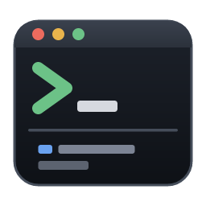

# Terminal Conductor



English | [日本語](README.ja.md)

A Windows terminal app for people who run [Claude Code](https://code.claude.com/docs/en/overview) in dozens of projects at once.

## Features

- **Two panes per project**: one for your AI CLI on top, one for commands below (cmd or PowerShell). Both are plain shells; nothing starts an AI on its own unless you turn that on.
- **Everything comes back after a restart**: open projects and split sizes are remembered. If a pane had a Claude Code conversation, it offers a **Resume** button that runs `claude --resume <session id>` (or turn on automatic start in Settings to resume without the click).
- **Status at a glance**: the sidebar shows whether the AI in each project is working, needs permission, is done, or hit an error — for Claude Code, Codex CLI and Antigravity CLI. Background projects that need you also raise a Windows notification.
- **Never wonder "what was this project again?"**: each project shows a one-line description, tags, Claude's last reply, the git branch and pending changes, and when it was last active. Claude can write a summary from the README and git log. Press Ctrl+K to search.
- **Bring your current conversations along**: a new project offers to continue the folder's latest Claude Code conversation with `claude --continue` (exit Claude in your other terminal first).
- **Find where a conversation happened**: Ctrl+Shift+F searches your past conversations with Claude Code, Codex CLI and Antigravity CLI (`agy`) by words, file names, errors or folder, then opens that folder and resumes the conversation. Off until you turn it on; see [Conversation search](#conversation-search).
- **English and Japanese UI**: follows the Windows display language by default; switch in Settings.
- **Automatic updates** from GitHub Releases. Download from Settings; the update is installed the next time you close the app (or restart and update right away).

## Install

Download `terminal-conductor_<version>_x64-setup.exe` from [Releases](https://github.com/cignoir/terminal-conductor/releases/latest) and run it. It installs for the current user and needs no administrator rights.

- The installer is not Authenticode-signed, so SmartScreen may warn on first run. Choose "More info" → "Run anyway".
- Updates are signed with the Tauri updater key, and the app only applies updates whose signature verifies.

### Requirements

- Windows 10 1809 or later (for ConPTY). Tested on Windows 11.
- [Claude Code](https://code.claude.com/docs/en/overview) with `claude` on your PATH. Tested with Claude Code 2.1.322.

## How it works with Claude Code

- Status comes from Claude Code [hooks](https://code.claude.com/docs/en/hooks). The app passes its hook settings each time it starts Claude, with `claude --settings <app data folder>\tc-hooks.json`. **Your `~/.claude/settings.json` is never modified**, and your own hooks keep working.
- Each pane's shell gets a `claude` alias that adds `--settings` (a doskey macro in cmd, a function in PowerShell), so typing `claude` yourself is tracked in either pane.
- **Codex CLI and Antigravity CLI** report their state to the terminal with OSC 7501 (`ESC ] 7501 ; state=working:app=codex BEL`); the app reads it from the pane's output, so no configuration of those tools is touched. Panes set `AGY_CLI_OSC7501=on` because Antigravity CLI only sends it to terminals it recognizes. Tested with Codex CLI 0.167.2 and Antigravity CLI 1.5.6. Automatic start and the Resume button are Claude Code only; for the others, use conversation search to resume.
- Hooks report the event name, session id, Claude's last reply and similar fields. They reach the app through a named pipe that only your user can write to, and are stored only in the app's data folder. Nothing is sent anywhere.
- The only network traffic is the update check (GitHub) and, when you press the button, summary generation via `claude -p` (Claude Code's own traffic).

## Conversation search

Press Ctrl+Shift+F (or "Conversations" in the sidebar) to search past AI conversations across tools and jump back into them.

| Tool | Reads | Searches | Resumes with |
|---|---|---|---|
| Claude Code | `~/.claude/projects/*/*.jsonl` | Your messages and Claude's replies | `claude --resume <id>` |
| Codex CLI | `~/.codex/sessions/**/rollout-*.jsonl[.zst]` | Your messages and Codex's replies | `codex resume <id>` |
| Antigravity CLI | `~/.gemini/antigravity-cli/conversation_summaries.db` | Title and preview | `agy --conversation <id>` |

Privacy and security:

- It is **off by default**. The first time you open it, it explains what it does and asks before building anything.
- To search quickly it keeps an index with a **copy of the conversation text** (not tool output). Anything you pasted into a conversation, such as keys or passwords, is in that copy too.
- The index is `%LOCALAPPDATA%\io.github.cignoir.terminal-conductor\history.db`, in the local (non-roaming) profile so it doesn't follow roaming profiles to a server. It is never sent anywhere. Deleted conversations are removed from it with SQLite `secure_delete`.
- Settings has **Delete index**, which removes the file. Your original conversation files are never modified; the Antigravity database is opened read-only.
- The resume command is typed into the top pane only when the conversation id is a plain id (letters, digits, `-`, `_`). If the pane was already running something, the app asks first and otherwise copies the command instead.

## Keyboard

| Keys | Action |
|---|---|
| Ctrl+K | Search and open a project |
| Ctrl+Tab / Ctrl+Shift+Tab | Cycle through open projects |
| Ctrl+1–9 | Go to the nth project |
| Alt+↑ / Alt+↓ | Move between the Claude and shell panes |
| Ctrl+C (with a selection) / Ctrl+Shift+C | Copy |
| Ctrl+V / right-click | Paste (right-click with a selection copies) |
| Shift+Enter | New line in Claude's prompt |
| Ctrl+Shift+F | Search past AI conversations |
| Ctrl+, | Settings |
| Right-click a project | Open in Explorer, open, edit, close |

Toolbar buttons are icons; hover or focus one to see what it does and its shortcut.

## Data

Stored in `%APPDATA%\io.github.cignoir.terminal-conductor\`:

| File | Contents |
|---|---|
| `projects.json` | The project list |
| `workspace.json` | Open projects and their order |
| `settings.json` | Settings |
| `sessions.json` | Each pane's Claude session id and last reply |
| `tc-hooks.json` | Hook settings passed with `claude --settings` (rewritten at every start) |
| `shell/` | Shell init files that define the `claude` alias (rewritten at every start) |

Uninstalling leaves this folder in place; delete it by hand if you no longer need it.

## Development

Requires Rust (stable) and Node.js 20.19 or later.

```sh
npm install
npm run tauri dev        # run in development
npm test                 # tc-core tests (cargo test -p tc-core)
npx tsc --noEmit         # type-check the frontend
npm run build:local      # unsigned release build (no updater artifacts)
```

`npm run tauri build` signs the updater artifacts and needs `TAURI_SIGNING_PRIVATE_KEY`; use `npm run build:local` without the key.

| Environment variable | Effect |
|---|---|
| `TC_DEBUG_INPUT=1` | Log input sent to the PTYs to stderr (development builds only) |
| `TC_UPDATE_ENDPOINT=<url>` | Override the update endpoint, to try the update flow locally (signatures are still verified) |
| `WEBVIEW2_ADDITIONAL_BROWSER_ARGUMENTS=--remote-debugging-port=9333` | Allow connecting to WebView2 over the DevTools protocol |

### Layout

```
crates/tc-core/   PTYs, hook receiver, status, launch settings, persistence (no Tauri types)
src-tauri/        Tauri commands and the updater; `<exe> hook` runs the hook client
src/              React frontend (xterm.js); UI strings live in src/i18n.ts
docs/             Design notes and the release procedure
```

### Translations

UI strings are in `src/i18n.ts`. English is the source; each other language must define every key, which the type checker enforces. To add a language, add a catalog there and an entry to `LANGUAGES`.

See [docs/RELEASING.md](docs/RELEASING.md) for releases and [docs/design.md](docs/design.md) (Japanese) for the design notes.

## License

[MIT](LICENSE)
